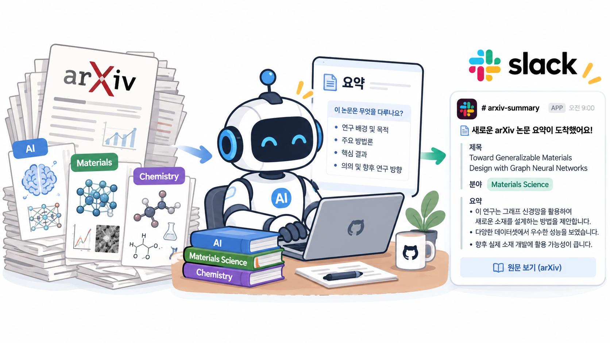

# arXiv Slack Bot

A bot that selects arXiv papers in AI, materials, and chemistry using keywords for topics of interest, writes Korean summaries, and automatically shares them on Slack.

AI·재료·화학 분야에서 관심 주제에 맞는 arXiv 논문을 키워드로 선별하고, 한국어 요약을 만들어 Slack에 자동 공유하는 봇입니다.

## Features

- Finds papers from the last 14 days using keywords for AI, materials, and chemistry.
- Uses OpenAI to write a Korean summary with three bullet points.
- Sends the title, authors, summary, and PDF link to Slack.
- Uses saved history to skip papers already sent. Google Sheets is optional.

## Connections

- **arXiv:** Reads titles and abstracts through the public OAI-PMH API. No API key is needed.
- **OpenAI:** Sends each paper's title and abstract to `gpt-4o-mini` for a summary.
- **Slack:** Posts each paper to a channel through an Incoming Webhook.
- **Google Sheets (optional):** Saves paper details and send history using a service account.

## Setup and API keys

1. Create a Slack app, enable **Incoming Webhooks**, and add a webhook to your channel.
2. Create an OpenAI API key.
3. In your GitHub repository, open **Settings → Secrets and variables → Actions** and add these repository secrets:

| Secret name | Value to save |
| --- | --- |
| `SLACK_WEBHOOK_URL` | Your Slack Incoming Webhook URL |
| `OPENAI_API_KEY` | Your OpenAI API key |
| `ARXIV_CONTACT_EMAIL` | Your contact email for arXiv requests |
| `GOOGLE_SHEETS_KEY` (optional) | Your spreadsheet ID |
| `GOOGLE_SERVICE_ACCOUNT_JSON` (optional) | Your Google service account JSON credentials |

For Google Sheets, also share the spreadsheet with the service account's email and give it edit access.

GitHub Secrets stores these values. GitHub Actions passes them to the bot as environment variables when it runs. The code reads them with `os.getenv()`.

Keep real API keys, webhook URLs, and service account credentials out of source code, documentation, commits, and logs.

## Run

GitHub Actions runs the bot on weekdays at 14:30 Asia/Seoul. You can also select **Actions → arXiv Slack Bot → Run workflow** to start it manually. Collection and summary generation take time, so Slack posts appear later.
